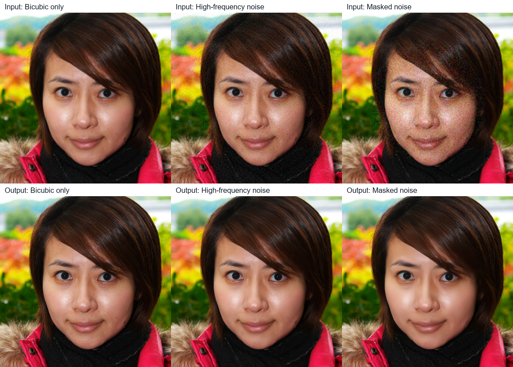

# Lightweight SwinIR-S：FFHQ 超解析實驗

以 FFHQ 人臉照片測試 bicubic、加入高頻雜訊與人臉區域雜訊三種低解析度輸入。實驗指標見 [Final-Project Spec #1](https://github.com/milin-chang/NYCU-2026-FALL-Multimedia/discussions/1)，失真設定見[不同失真等級 #5](https://github.com/milin-chang/NYCU-2026-FALL-Multimedia/discussions/5)。

## 流程

```text
FFHQ HR → bicubic x4 縮小成 LR → 視實驗加入雜訊 → SwinIR-S → SR
                                                        ↓
                                             與 HR 計算 L1 loss
驗證集選最佳權重 → 獨立測試集推論與評分
```

訓練、驗證、測試使用固定的 400／50／50 切分。訓練過程和最後測試的八項品質指標見各實驗報告。另有從指定 Kaggle 版本抽取 1000／125／125 張的資料準備腳本；它採用 Real-world SR 的 BSRGAN 降質流程，與本實驗的 bicubic LR 不同，詳見 [資料準備說明](scripts/ffhq_baseline/README.md)。

## 範例結果



## 資料夾

- `src/`：模型、資料準備、訓練及評估程式。
- `spec/`：固定的實驗設定與資料切分 manifest。
- `reports/`：評分結果與視覺化。
- `runs/`：訓練紀錄、權重與測試輸出，保留在本機。
- `metrics/`：獨立的範例照片品質指標工具。

下一階段依[開會紀錄](https://github.com/milin-chang/NYCU-2026-FALL-Multimedia/discussions/2)討論是否加入 degradation-aware SR，根據色偏、雜訊與模糊條件調整模型。
