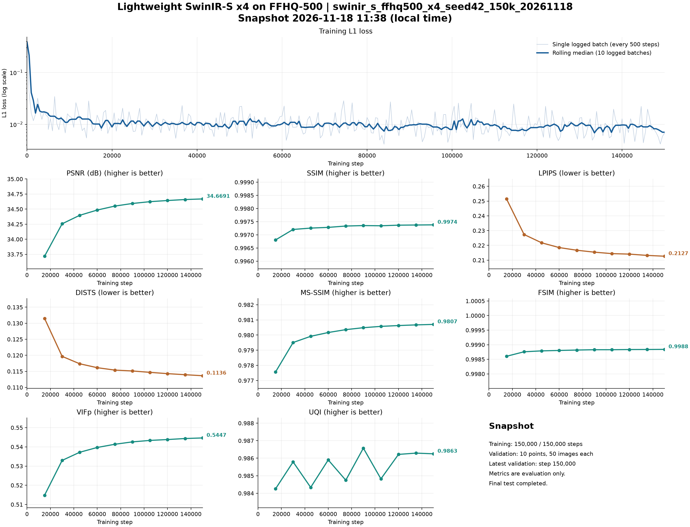
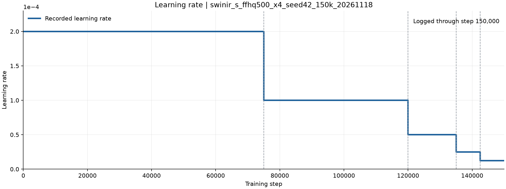
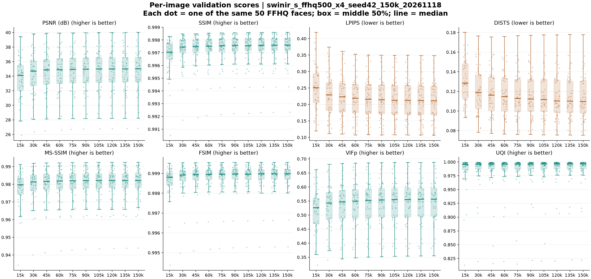
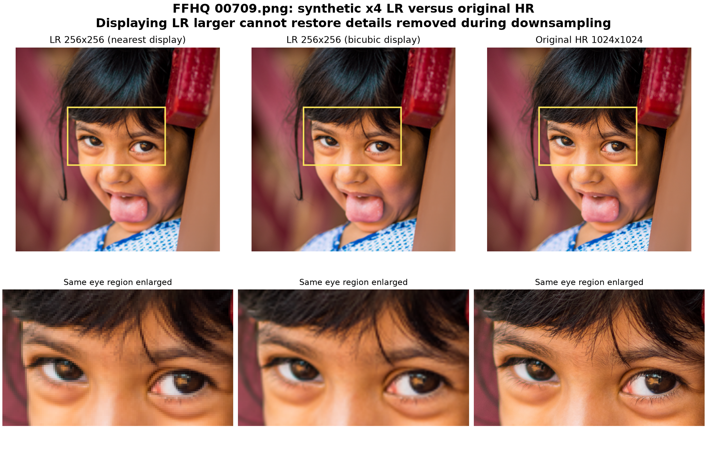
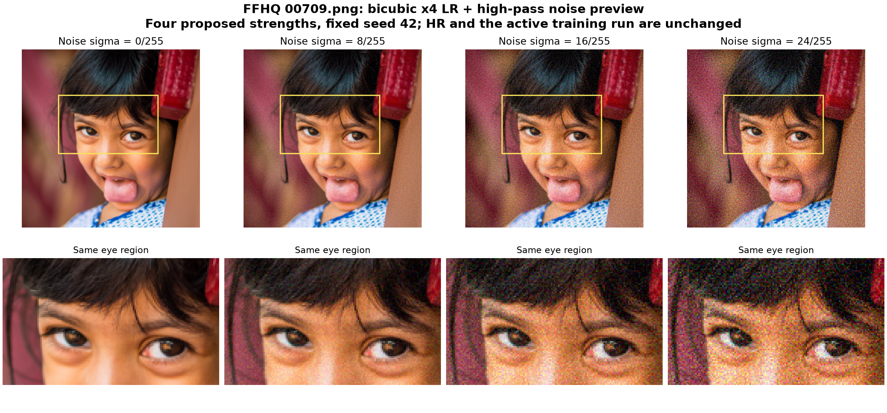
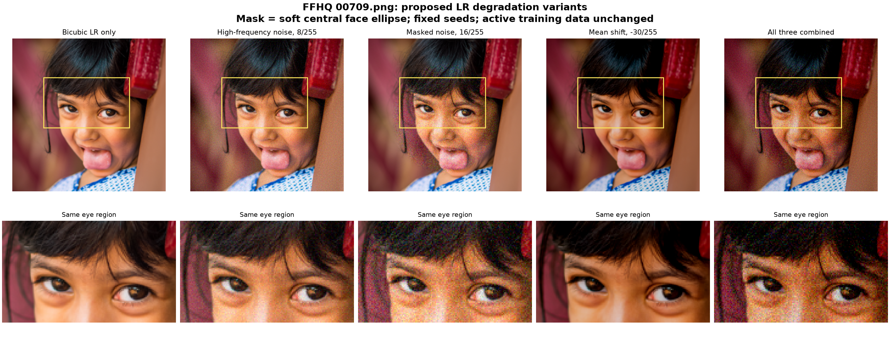

# 訓練圖表

這些圖是訓練進行中的快照，由 `src/plot_convergence.py` 根據 `runs/` 內的紀錄產生。執行一次才更新一次；圖上的訓練步數是擷取當時的進度。

## 收斂趨勢

## 學習率

虛線為設定的學習率調整步數；實線只畫到已訓練完成的步數。

## 逐張驗證分數

每個點是一張 FFHQ 驗證影像。每次驗證使用相同的 50 張；箱體為中間 50% 的分數，橫線為中位數。八項指標只用於評分，不參與模型訓練。

## LR 與 HR 範例

左、中兩欄都來自 `dataset/ffhq_lightweight_x4/lr/00709.png`（256×256），只是用不同方式放大顯示；右欄是 `dataset/ffhq_1024/00709.png`（1024×1024）原圖。下排比較同一個眼部區域，方便觀察眉毛、睫毛和髮絲細節。這張圖沒有包含模型輸出。

## Bicubic LR 加高頻雜訊預覽

此圖只測試視覺效果：先使用既有 256×256 bicubic LR，再用固定 seed 42 的高通 Gaussian 雜訊，分別加入 0、8、16、24／255 強度。這是本專案提出的可重現預覽，並非宣稱完全重現 TID2013 的失真生成方式。HR、既有 LR 檔案及正在執行的模型訓練均未改動。

## Masked noise 與 Mean shift 預覽

五欄依序為原 LR、高頻雜訊（8／255）、局部遮罩雜訊（16／255）、整張亮度下移（−30／255）、三者合併。局部遮罩雜訊只在臉部中央的柔和橢圓區域加入 Gaussian 雜訊；這是本專案定義的可重現版本，不宣稱等同 TID2013 的 Masked noise。此圖只供觀察，未更改正在執行的 baseline 訓練資料。
