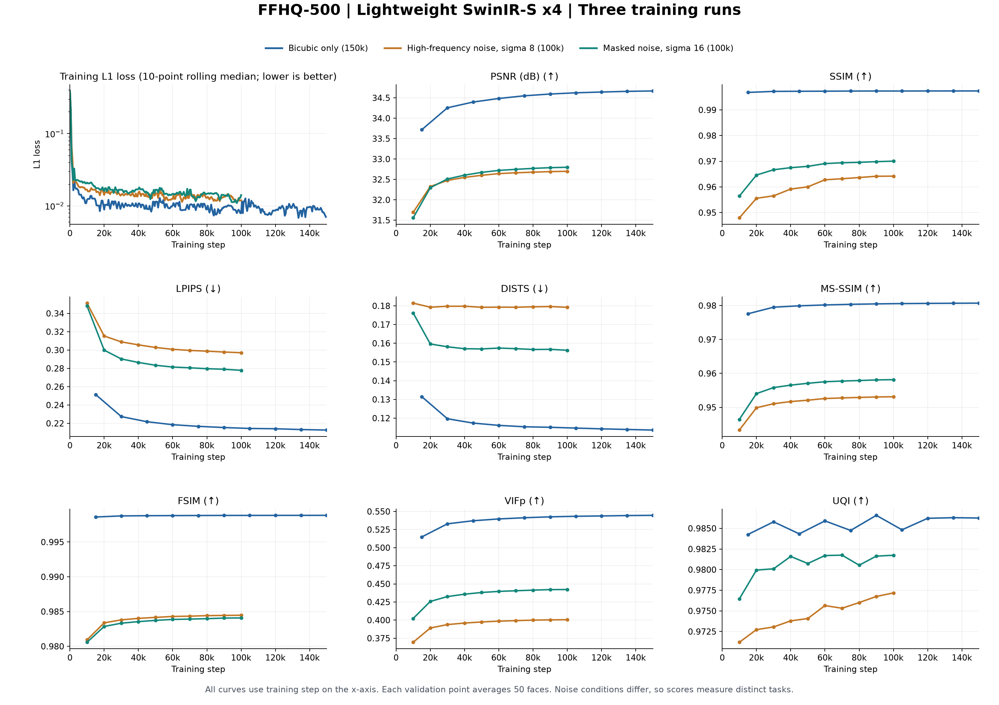
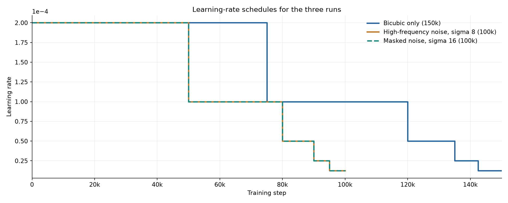
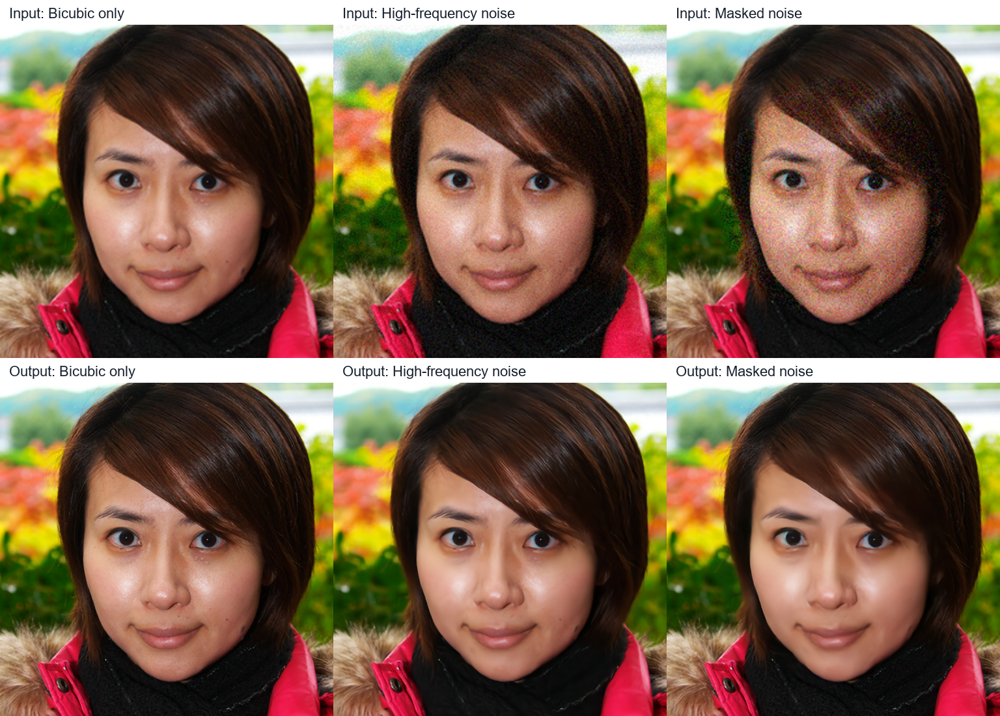
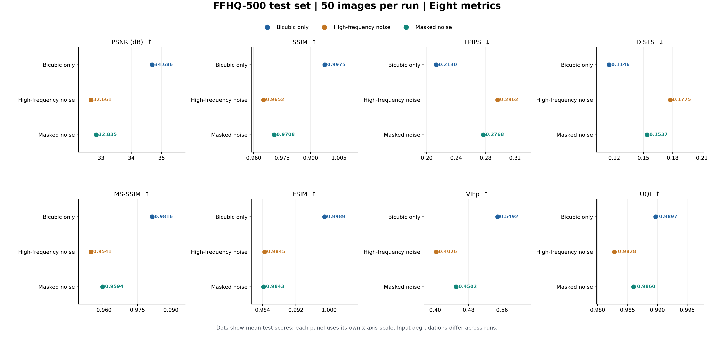

# FFHQ 500：三組 Lightweight SwinIR-S 收斂與測試影像

## 實驗材料與方法

三組使用同一份 FFHQ 500 張切分（seed 42：訓練 400、驗證 50、測試 50），模型都是從零訓練的 Lightweight SwinIR-S ×4。HR 為 1024 × 1024；LR 由 bicubic 降採樣至 256 × 256，再依組別加入雜訊。評分指標只用於驗證與測試，不參與訓練。

| 圖中名稱 | LR 輸入 | 訓練步數 | 驗證間隔 |
| --- | --- | ---: | ---: |
| Bicubic only | bicubic 降採樣 | 150,000 | 15,000 |
| High-frequency noise | bicubic 後加入高頻雜訊，標準差 8/255 | 100,000 | 10,000 |
| Masked noise | bicubic 後在中央柔邊遮罩內加入雜訊，標準差 16/255 | 100,000 | 10,000 |

## 收斂圖



每個指標點是同組 50 張驗證影像的平均值。訓練 loss 取每 500 步記錄一次的值，再以連續 10 筆的中位數平滑；因此圖上的 loss 不是所有訓練步的平均。橫軸都是實際訓練步數，原始組延伸至 150,000 步，另兩組在 100,000 步結束。三組在各自的退化條件下，驗證 PSNR 隨訓練上升；原始組的任務較單純，不能將不同輸入條件的絕對分數當成同一任務的公平排名。



兩組 100,000 步實驗使用相同學習率排程，因此橘色實線與綠色虛線重疊。

各組的完整圖另存於各自 `reports/<run 名稱>/convergence.png`、`learning_rate.png` 與 `per_image_validation.png`。

## 單張測試影像推論

選用共同測試集的 **`00747.png`**。每組分別讀取自己的 256 × 256 LR、載入自己的 `best.pth` 中 EMA 權重，輸出 1024 × 1024 SR。重新推論的三張結果都與訓練結束時保存的測試影像逐像素一致。



圖的上排是各組 LR 以 bicubic 放大後的**顯示預覽**；模型實際輸入仍是 256 × 256。下排是模型輸出的 SR。臉部局部裁切可在 [細節對照圖](example_00747/face_detail.png) 中查看，完整解析度的 LR、HR、SR PNG 都在 `example_00747/`。

| 組別 | 此張測試影像 PSNR ↑ | LPIPS ↓ |
| --- | ---: | ---: |
| Bicubic only | 34.031 | 0.2051 |
| High-frequency noise | 32.167 | 0.3038 |
| Masked noise | 32.518 | 0.2849 |

這些分數與圖像描述的是各自退化條件下的重建結果。從局部圖可觀察到兩組去雜訊結果較平滑；是否更符合人類偏好，需要另外做主觀評分，不能只由這張圖或上述指標推論。

## 重現圖與推論

在專案根目錄使用同一個 `.venv`：

```powershell
& .\src\.venv\Scripts\python.exe .\src\plot_three_runs.py
& .\src\.venv\Scripts\python.exe .\src\render_best_examples.py --image 00747.png
```

每張影像使用的 run、checkpoint SHA-256 與輸入輸出路徑記錄在 [`example_00747/provenance.json`](example_00747/provenance.json)。

### 第二張測試影像：`04206.png`

同樣使用三組各自的 `best.pth`，重新推論共同測試集中的 `04206.png`。可查看 [三組輸入與輸出並排圖](example_04206/input_vs_output.png)、[臉部細節對照圖](example_04206/face_detail.png) 與 [推論紀錄](example_04206/provenance.json)。原尺寸 HR、LR 與三張 1024 × 1024 SR 圖片保存在 `example_04206/`。

### 第三張測試影像：`56651.png`

依使用者指定，使用共同測試集的 `56651.png` 製作另一組 [三組輸入與輸出並排圖](example_56651/input_vs_output.png)。另有 [臉部細節對照圖](example_56651/face_detail.png) 與 [推論紀錄](example_56651/provenance.json)；`example_56651/` 也保存原尺寸的 HR、LR 與三張 SR 圖片。

這張影像的 SR 與 HR 比較分數，取自各組測試結果的 `per_image.csv`：

| 組別 | PSNR ↑ | SSIM ↑ | LPIPS ↓ | DISTS ↓ | MS-SSIM ↑ | FSIM ↑ | VIFp ↑ | UQI ↑ |
| --- | ---: | ---: | ---: | ---: | ---: | ---: | ---: | ---: |
| Bicubic only | 33.5075 | 0.9969 | 0.2653 | 0.1497 | 0.9803 | 0.9991 | 0.5295 | 0.9980 |
| High-frequency noise | 32.5613 | 0.9786 | 0.3293 | 0.1977 | 0.9648 | 0.9893 | 0.4336 | 0.9965 |
| Masked noise | 32.4001 | 0.9807 | 0.3067 | 0.1807 | 0.9667 | 0.9881 | 0.4480 | 0.9948 |

## 完整測試集重新評估

另以三組 `best.pth` 的 EMA 權重，重新推論各自測試條件下的同一批 50 張影像，並對每張 SR 與 HR 重算八項指標。下表是每組 50 張影像的平均值；這是 **test set** 的分數，不是前述收斂圖中的 validation 分數。

| 組別 | PSNR ↑ | SSIM ↑ | LPIPS ↓ | DISTS ↓ | MS-SSIM ↑ | FSIM ↑ | VIFp ↑ | UQI ↑ |
| --- | ---: | ---: | ---: | ---: | ---: | ---: | ---: | ---: |
| Bicubic only | 34.6864 | 0.9975 | 0.2130 | 0.1146 | 0.9816 | 0.9989 | 0.5492 | 0.9897 |
| High-frequency noise | 32.6609 | 0.9652 | 0.2962 | 0.1775 | 0.9541 | 0.9845 | 0.4026 | 0.9828 |
| Masked noise | 32.8352 | 0.9708 | 0.2768 | 0.1537 | 0.9594 | 0.9843 | 0.4502 | 0.9860 |



每個點代表該組 50 張 test 影像的平均值。各小圖的橫軸範圍獨立設定，以便看出同一指標內的數值差異；不同指標之間不能直接比較點距。箭頭表示分數方向。

另提供[八項指標柱狀圖](test_metrics_bar_comparison.png)。每個小圖的縱軸都從 0 開始，柱頂標示精確平均值；接近 1 的指標差異看起來會較小，請同時參照數值標籤。

重新評估的 150 筆逐張分數與原測試紀錄完全相同。完整數值及 checkpoint SHA-256 見 [`test_reevaluation/results.json`](test_reevaluation/results.json)；三組逐張 CSV 分別在 `test_reevaluation/bicubic/`、`highfreq/`、`masked/`。可在專案根目錄執行 `& .\src\.venv\Scripts\python.exe .\src\reevaluate_three_tests.py` 重現。
