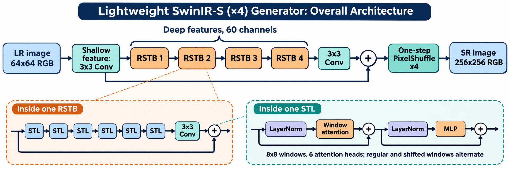

# FFHQ 500 張與 Lightweight SwinIR-S ×4 GPU 測速

這裡的程式用現有的 `dataset/ffhq_1024` 做一個可重現的小型實驗。`prepare_ffhq.py` 只產生檔名清單，不複製或修改原圖。`benchmark_swinir.py` 會從隨機權重開始，對官方 KAIR 設定的 Lightweight SwinIR-S ×4 做真正的短程訓練更新，量測這台 GPU 的每步時間。**測速產生的模型不會保存，也不能當成訓練完成的模型。**



圖中 LR 輸入經淺層卷積、4 個 RSTB、長距離殘差連接與一步式 PixelShuffle，得到 ×4 SR 輸出。每個 RSTB 包含 6 個 STL。這是便於理解的原創示意圖，細節以 `network_swinir.py` 為準。

## 資料切分

從已下載的 4,000 張 FFHQ 中，以 Python `random.Random(42)` 固定抽取 500 張，分成訓練 400、驗證 50、測試 50。結果寫在 `dataset/ffhq_split_seed42_500.json`；三組檔名不重複。

在專案根目錄開啟 PowerShell：

```powershell
& .\metrics\.venv\Scripts\python.exe .\src\prepare_ffhq.py
```

可執行 `& .\metrics\.venv\Scripts\python.exe .\src\prepare_ffhq.py --help` 查看切分參數。若要改張數，請同時指定 `--train`、`--val`、`--test` 以及新的 `--out` 路徑。

## CUDA 環境與官方原始碼

`src/network_swinir.py` 是從 [官方 KAIR 的 SwinIR 模型程式](https://github.com/cszn/KAIR/blob/fc1732f4a4514e42ce15e5b3a1e18c828af47a1e/models/network_swinir.py) 複製的架構原始碼，之後要改模型就修改這份檔案；原始碼授權見 `src/LICENSE-KAIR`。`src/upstream/KAIR` 由 `gh` 取得並固定在 commit `fc1732f4a4514e42ce15e5b3a1e18c828af47a1e`，目前用來提供 `utils/utils_image.py` 的 bicubic 縮圖與成對增強函式。上游 clone 與虛擬環境不會提交進目前的 Git repository；在新的環境可用以下命令準備：

```powershell
powershell -NoProfile -ExecutionPolicy Bypass -File .\src\setup.ps1
```

此命令需要 `gh`、專案既有的 `metrics/.tools/uv/uv.exe` 和網路；會建立 `src/.venv`，並安裝 CUDA 12.8 版 PyTorch。現有 `metrics/.venv` 是 CPU 版，不能用它執行 GPU 測速。

## 製作固定的 ×4 bicubic 輸入圖

使用 KAIR 的 `imresize_np`，將 500 張完整 HR 影像各縮成 256×256 的 LR PNG；訓練時再從成對影像裁切對齊區塊。這些生成圖儲存在 `dataset/ffhq_lightweight_x4/lr`，原圖保持不變。

```powershell
& .\src\.venv\Scripts\python.exe .\src\prepare_lightweight_lr.py
```

## 用 CLI 跑 GPU 測速

```powershell
& .\src\.venv\Scripts\python.exe .\src\benchmark_swinir.py --steps 10 --warmup 2 --batch 1
```

每一步都從一組 FFHQ HR／bicubic LR 圖裁出對齊的 256×256／64×64 區塊，對兩張圖施加相同的隨機翻轉或旋轉，然後執行一次 SwinIR-S ×4 的 L1 損失、反向傳播和 Adam 更新。前 2 步用於預熱，不計入平均時間。輸出會分別顯示資料準備時間、GPU 更新時間、總時間和顯存峰值；完整紀錄寫到 `src/runs/benchmark_lightweight_500.json`。可用 `--help` 查看其餘參數。

這是**Lightweight classical ×4 SR 的短程測速**，不包含 GAN，也未對驗證集或測試集評分。500 張只改變資料量；若設定固定的訓練步數，不會讓每步 GPU 計算自動縮短。正式實驗仍須讓原版與修改架構版使用同一份切分、訓練步數和評估方式。

## 本機量測結果

在 RTX 5070 Ti、PyTorch 2.11.0+cu128、BF16、batch 1 的條件下，以 2 步預熱、10 步計時：

| 項目 | 量測值 |
| --- | ---: |
| 每步總時間平均 | 0.130 秒 |
| 其中資料準備平均 | 0.046 秒 |
| 其中模型更新平均 | 0.084 秒 |
| PyTorch GPU 記憶體配置峰值 | 0.43 GiB |

模型有 929,628 個參數；輸入是 `1×3×64×64`，輸出與目標都是 `1×3×256×256`。依短測平均推算，5 萬步的訓練迴圈約 1.8 小時；這份報告沒有包含啟動、正式驗證、測試或儲存 checkpoint，因此不能直接當作完整實驗的總耗時。先前的 `src/runs/benchmark_500.json` 是 SwinIR-M＋BSRGAN 的舊測速紀錄，實驗條件不同。

正式訓練與評分流程見 [TRAINING.md](TRAINING.md)。
